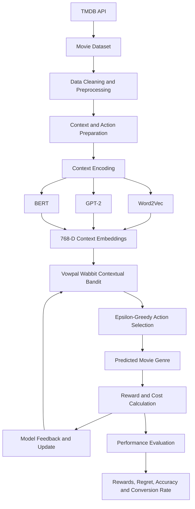

# Improved Decision Making Through LLM-Augmented Contextual Bandits

## Overview

This project investigates whether Large Language Models (LLMs) can improve the decision-making performance of contextual bandit algorithms by generating richer representations of contextual information.

Traditional contextual bandits use contextual features to estimate the rewards associated with different actions. However, when context contains complex natural-language information, representing and interpreting that information effectively can be challenging.

To address this, this project integrates pretrained language models as **context encoders**. GPT-2 and BERT generate dense vector embeddings from textual movie information, which are then used by a Vowpal Wabbit contextual bandit to select actions.

The approach is evaluated using a real-world movie dataset obtained from The Movie Database (TMDB). Three context representation techniques are compared:

- Word2Vec
- GPT-2
- BERT

The models are evaluated using cumulative rewards, cumulative regret, average rewards, average regret, action accuracy, and conversion rate.

**Key finding:** GPT-2 and BERT consistently outperform Word2Vec across the tested exploration probabilities. BERT achieves the highest cumulative reward and lowest cumulative regret at an epsilon value of 0.05.

---

## Table of Contents

1. [Background](#1-background)
2. [Problem Statement](#2-problem-statement)
3. [Existing Limitations](#3-existing-limitations)
4. [Proposed System](#4-proposed-system)
5. [Key Capabilities](#5-key-capabilities)
6. [Architecture](#6-architecture)
7. [Workflow](#7-workflow)
8. [Evaluation Methodology](#8-evaluation-methodology)
9. [Results](#9-results)
10. [Learnings](#10-learnings)
11. [Future Work](#11-future-work)

---

## 1. Background

### Contextual Bandits

A contextual bandit is a machine learning approach that learns to make decisions by selecting actions based on the context available at a particular time.

Unlike a traditional multi-armed bandit, which selects actions based primarily on previously observed rewards, a contextual bandit also considers contextual information when making decisions.

The general interaction involves:

1. Receiving contextual information about the current situation.
2. Selecting an action based on the available context and learned policy.
3. Observing the reward associated with the selected action.
4. Updating the model using the observed feedback.
5. Repeating the process to improve future decisions.

The objective is to maximize cumulative rewards over a sequence of decisions.

The expected reward for selecting an action can be represented as:

\[
Q_t(a_t \mid x_t) = E[r_t \mid x_t]
\]

Where:

- \(x_t\) represents the context at time \(t\).
- \(a_t\) represents the selected action.
- \(r_t\) represents the observed reward.
- \(Q_t\) represents the expected reward.

The model aims to maximize cumulative expected rewards:

\[
\max \sum\_{t=1}^{T} E[r_t]
\]

### Role of Large Language Models

Large Language Models can generate dense numerical representations of natural-language information.

These representations, commonly called embeddings, capture semantic relationships between words and contextual information.

Instead of directly providing raw textual context to the contextual bandit, an LLM can encode the information into a numerical vector:

\[
LLMEncode(x_t) = e(x_t)
\]

The contextual bandit then uses this encoded representation to select actions:

\[
Q_t(a_t \mid e(x_t)) = E[r_t \mid e(x_t)]
\]

This project explores whether richer contextual representations generated by pretrained language models can improve contextual bandit decision-making.

**Important:** The LLMs in this project act as context encoders. The contextual bandit remains responsible for action selection, reward estimation, and policy updates.

---

## 2. Problem Statement

Contextual bandits rely on contextual information to make decisions and learn from feedback.

However, real-world contextual information can contain:

- High-dimensional feature representations.
- Complex natural-language descriptions.
- Sparse or noisy information.
- Relationships between different textual attributes.
- Contextual dependencies that are difficult to represent using conventional techniques.

When textual information is converted into numerical features, the quality of those representations can influence the decisions made by the contextual bandit.

A representation that does not sufficiently capture semantic relationships may limit the model's ability to distinguish between different contexts and identify rewarding actions.

### Research Objective

The primary objective of this project is to investigate:

**Can integrating pretrained Large Language Models as context encoders improve the performance of contextual bandits compared with conventional word embedding techniques?**

The study specifically compares Word2Vec, GPT-2, and BERT to determine their impact on:

- Cumulative rewards.
- Cumulative regret.
- Average reward per prediction.
- Average regret per prediction.
- Action prediction accuracy.
- Conversion rate across available actions.

---

## 3. Existing Limitations

Traditional contextual bandit approaches can encounter challenges when working with complex contextual information.

### 3.1 Context Representation

The effectiveness of a contextual bandit depends partly on how the available context is represented.

Conventional representations may not capture all the semantic relationships and contextual dependencies present in natural-language information.

### 3.2 High-Dimensional Context

Real-world data can contain multiple attributes with different characteristics.

Processing and representing these attributes can introduce additional computational complexity, particularly when the contextual information includes lengthy textual descriptions.

### 3.3 Limited Semantic Understanding

Traditional embedding techniques such as Word2Vec learn word representations based on relationships observed in their training data.

However, pretrained transformer-based models can leverage contextual information when generating representations.

For example, BERT uses bidirectional attention, while GPT-2 uses causal, left-to-right attention.

This provides an opportunity to investigate whether contextualized embeddings lead to better downstream decisions.

### 3.4 Decision Quality

The quality of the contextual representation can affect the bandit's ability to identify rewarding actions.

Poorer representations may result in lower cumulative rewards and higher cumulative regret.

This research evaluates whether pretrained language models can address these challenges by providing richer representations of contextual information.

---

## 4. Proposed System

The proposed system integrates pretrained language models with a contextual bandit algorithm.

Instead of relying exclusively on conventional word embeddings, the system uses GPT-2 and BERT to generate dense representations of textual contextual information.

These embeddings are supplied to a Vowpal Wabbit contextual bandit model, which learns to select actions based on the encoded context and previously observed feedback.

### Context Representation Techniques

Three different representation techniques are evaluated.

#### Word2Vec

Word2Vec is used as the conventional embedding baseline.

- Trained using the movie dataset's textual information.
- Implemented using Gensim.
- Generates embeddings for movie titles, overviews, and keywords.
- Produces 768-dimensional vector representations in this experiment.

#### GPT-2

GPT-2 is a pretrained transformer-based language model.

The implementation uses its pretrained tokenizer and model to generate contextual representations.

The processing involves:

1. Tokenizing the input text.
2. Generating token embeddings and positional embeddings.
3. Processing the tokens through transformer layers.
4. Extracting the output embeddings from the last transformer layer.

GPT-2 uses causal self-attention, allowing each token to attend to preceding tokens.

The resulting representations have 768 dimensions.

#### BERT

BERT is a pretrained bidirectional transformer-based language model.

The implementation uses its pretrained tokenizer and model to generate contextual representations.

The processing involves:

1. Tokenizing the input text.
2. Generating token representations.
3. Processing the tokens through bidirectional transformer layers.
4. Extracting the output embeddings from the last transformer layer.

Unlike GPT-2, BERT considers information from both preceding and succeeding tokens when building contextual representations.

The resulting representations have 768 dimensions.

### Contextual Bandit Algorithm

The project uses Vowpal Wabbit's `cb_explore` contextual bandit implementation.

The epsilon-greedy exploration strategy is used to balance exploration and exploitation.

- **Exploration:** Select an action to gather additional feedback.
- **Exploitation:** Select an action based on the model's learned estimates.

The epsilon parameter controls the exploration probability:

\[
P(\text{exploration}) = \epsilon
\]

\[
P(\text{exploitation}) = 1-\epsilon
\]

The experiments evaluate three epsilon values:

- 0.01
- 0.05
- 0.10

The contextual bandit receives the selected action's cost as feedback and updates its learned policy.

---

## 5. Key Capabilities

### 5.1 LLM-Based Context Encoding

Uses pretrained GPT-2 and BERT models to transform natural-language movie information into dense, 768-dimensional contextual representations.

### 5.2 Comparative Embedding Evaluation

Compares three different representation techniques:

- Word2Vec
- GPT-2
- BERT

This allows the impact of context representation on contextual bandit performance to be evaluated.

### 5.3 Contextual Decision-Making

Uses Vowpal Wabbit's `cb_explore` algorithm to select actions based on contextual features and learned reward estimates.

### 5.4 Exploration and Exploitation

Implements epsilon-greedy exploration to investigate the effect of different exploration probabilities on cumulative rewards and regret.

### 5.5 Online Feedback and Model Updates

After an action is selected, the observed cost and corresponding reward are calculated and fed back to the contextual bandit for model updates.

### 5.6 Real-World Dataset Evaluation

Uses actual movie metadata collected through TMDB APIs, including movie titles, overviews, keywords, genres, and release dates.

### 5.7 Multiple Performance Metrics

Evaluates the models using cumulative rewards, cumulative regret, average rewards, average regret, action accuracy, and conversion rates.

---

## Dataset

### The Movie Database (TMDB)

This project uses real-world movie metadata collected from [The Movie Database (TMDB)](https://www.themoviedb.org/) through its API endpoints.

Two API endpoints are used to collect the information required for the experiments:

- **Movie Details API:** Retrieves movie titles, genres, overviews, and release dates.
- **Movie Keywords API:** Retrieves keywords associated with individual movies.

The API responses are retrieved in JSON format using Python's `requests` library and stored in CSV files for preprocessing and experimentation.

### Dataset Attributes

The dataset contains the following attributes:

| Attribute    | Description                           |
| ------------ | ------------------------------------- |
| Movie ID     | Unique identifier for each movie      |
| Title        | Movie title                           |
| Overview     | Textual description of the movie      |
| Keywords     | Keywords associated with the movie    |
| Genres       | Original genres assigned to the movie |
| Release Date | Movie release date                    |

### Data Preparation

The initial dataset consists of 10,000 selected movie records. The data is cleaned and preprocessed to handle missing values, empty fields, inconsistencies, and formatting issues.

There are 19 unique movie genres in the dataset. Each genre is assigned a numerical action ID using a genre-index mapping dictionary.

To formulate the problem as a contextual bandit task, each movie is replicated for all 19 possible genre actions.

\[
10,000 \text{ movies} \times 19 \text{ actions}
= 190,000 \text{ records}
\]

This transformation creates a movie-action pair for every possible genre recommendation, allowing the model to learn the cost associated with each action.

### Training and Testing Split

The resulting 190,000 records are divided into training and testing datasets using an 80:20 split.

| Dataset   |    Split | Number of Records |
| --------- | -------: | ----------------: |
| Training  |      80% |           152,000 |
| Testing   |      20% |            38,000 |
| **Total** | **100%** |       **190,000** |

### Contextual Bandit Mapping

The dataset attributes are mapped to the contextual bandit components as follows:

| Component | Dataset Representation                                                           |
| --------- | -------------------------------------------------------------------------------- |
| Context   | Movie ID, title, keywords, overview, and release date                            |
| Actions   | 19 available movie genres                                                        |
| Reward    | Reward calculated from the predicted genre's position in the original genre list |
| Policy    | Epsilon-greedy exploration strategy                                              |

The textual attributes (title, overview, and keywords) are encoded using Word2Vec, GPT-2, and BERT to generate 768-dimensional embeddings.

Movie ID and release date are retained as numerical contextual attributes and are not used for text embedding generation.

The original ordering of the movie genres is preserved to calculate the cost and reward associated with each selected action.

This dataset formulation enables the contextual bandit to learn how different contextual representations influence genre recommendation decisions.

---

## 6. Architecture

The system consists of two primary components:

1. **Context encoding:** Word2Vec, GPT-2, or BERT transforms textual movie attributes into numerical embeddings.
2. **Decision-making:** Vowpal Wabbit uses the encoded contextual information to select a genre and learn from feedback.

### High-Level Architecture



### Contextual Bandit Input

The contextual bandit receives the encoded context and a set of available actions.

The Vowpal Wabbit contextual bandit input format is represented as:

```text
action : cost | context
```

Here:

- `action` identifies the selected action.
- `cost` represents the observed cost associated with the selected action.
- `context` contains the numerical contextual features.

The selected action and observed cost are used to update the contextual bandit's model.

---

## 7. Workflow

### Step 1: Data Collection

Movie information is collected from TMDB using its API endpoints.

Two types of API information are retrieved:

- Movie details: title, genres, overview, and release date.
- Movie keywords: keywords associated with each movie.

The API responses are processed from JSON and stored in CSV format using Python's `requests` library.

### Step 2: Data Preprocessing

The original dataset contains 10,000 selected movie records.

The dataset is cleaned to handle:

- Missing and empty values.
- Data inconsistencies.
- Formatting and normalization issues.

The following attributes are retained:

| Attribute    | Description                        |
| ------------ | ---------------------------------- |
| Movie ID     | Unique movie identifier            |
| Title        | Movie title                        |
| Overview     | Natural-language movie description |
| Keywords     | Associated movie keywords          |
| Genres       | Movie's original genre information |
| Release Date | Movie release date                 |

There are 19 unique movie genres in the dataset.

Each genre is assigned a numerical action ID using a genre-index mapping dictionary.

### Step 3: Action Preparation

Each movie is replicated for every possible genre action.

With 10,000 movies and 19 available genre actions:

\[
10,000 \times 19 = 190,000
\]

This produces 190,000 movie-action records.

The purpose of this transformation is to associate every movie context with all possible genre actions and their corresponding costs.

The resulting dataset is divided into:

| Dataset   | Percentage |     Records |
| --------- | ---------: | ----------: |
| Training  |        80% |     152,000 |
| Testing   |        20% |      38,000 |
| **Total** |   **100%** | **190,000** |

### Step 4: Context Embedding Generation

The textual attributes are encoded using the three representation techniques.

| Context attribute | Word2Vec  | GPT-2     | BERT      |
| ----------------- | --------- | --------- | --------- |
| Movie title       | Embedding | Embedding | Embedding |
| Movie overview    | Embedding | Embedding | Embedding |
| Movie keywords    | Embedding | Embedding | Embedding |

Each technique produces 768-dimensional embeddings.

Movie ID and release date are retained as numerical contextual attributes but are not used for generating text embeddings.

### Step 5: Contextual Bandit Training

The encoded training data is supplied to Vowpal Wabbit.

The `cb_explore` algorithm uses epsilon-greedy exploration to learn the relationship between contextual features, selected actions, and observed costs.

Separate experiments are performed using Word2Vec, GPT-2, and BERT representations.

### Step 6: Testing and Online Updates

The trained models are evaluated using the 38,000 test records.

Each experiment runs for 300 iterations.

During each iteration:

1. The test records are shuffled.
2. Each record is presented to the contextual bandit.
3. The model selects a genre action.
4. The selected action is evaluated against the movie's original genre information.
5. The corresponding cost and reward are calculated.
6. The feedback is supplied to the contextual bandit for an online update.

This process allows the model to continue learning from feedback during the evaluation iterations.

The maximum possible cumulative reward per iteration is 38,000.

Across 300 iterations:

\[
38,000 \times 300 = 11,400,000
\]

---

## 8. Evaluation Methodology

The project evaluates the contextual bandit models using multiple metrics.

### 8.1 Reward Function

A movie can belong to multiple genres, and the original ordering of the genres is used to represent their relative importance.

The first genre is treated as the highest-ranked genre.

The cost function is defined as:

\[
cost(a,x)=
\begin{cases}
1 & \text{if the predicted genre is not in the genre list}\\
0 & \text{if the predicted genre has index }0\\
\frac{index(a)}{|G_x|} & \text{otherwise}
\end{cases}
\]

Where:

- \(a\) represents the selected genre action.
- \(x\) represents the movie context.
- \(G_x\) represents the movie's original genre list.
- \(index(a)\) represents the zero-based position of the predicted genre in that list.
- \(|G_x|\) represents the number of genres associated with the movie.

The reward is calculated as:

\[
Reward(a,x)=1-Cost(a,x)
\]

For example, consider a movie whose original genre IDs are:

```text
[1, 5, 11]
```

| Predicted genre action |  Cost | Reward |
| ---------------------- | ----: | -----: |
| 1                      |     0 |   1.00 |
| 5                      | 0.333 |  0.667 |
| 11                     | 0.667 |  0.333 |
| 2                      |     1 |      0 |

This approach gives the highest reward to the first-ranked genre, lower rewards to subsequent relevant genres, and zero reward to an unrelated genre.

### 8.2 Cumulative Reward

Cumulative reward measures the total reward obtained over multiple decisions.

\[
CumulativeReward(T)=\sum\_{t=1}^{T}r_t
\]

A higher cumulative reward indicates better decision-making performance under the defined reward function.

### 8.3 Cumulative Regret

Cumulative regret measures the difference between the reward obtained by the selected actions and the best possible reward under the experiment's reward definition.

For this project, regret is calculated as:

\[
Regret(T)=\sum\_{t=1}^{T}(r_t^\*-r_t)
\]

Where:

- \(r_t^\*\) is the maximum achievable reward for the given movie context.
- \(r_t\) is the reward obtained by the selected action.

A lower cumulative regret indicates that the model is making decisions closer to the best available action.

### 8.4 Average Reward and Average Regret

Average reward and average regret measure the corresponding metrics per prediction.

For each prediction:

\[
0 \leq Reward \leq 1
\]

\[
0 \leq Regret \leq 1
\]

These metrics provide a normalized view of model performance.

### 8.5 Model Accuracy

For this experiment, accuracy is defined as the number of predictions where the selected genre belongs to the movie's original genre list.

A prediction is considered accurate if the recommended genre is one of the actual genres associated with that movie.

This is a project-specific action correctness measure rather than conventional multiclass classification accuracy.

### 8.6 Conversion Rate

Conversion rate measures how frequently a recommended action produces a desired outcome.

For this study, a prediction is considered successful when the selected genre belongs to the movie's original genre list, resulting in a reward greater than zero.

The conversion rate is evaluated across all 19 available actions.

### 8.7 Experiment Configurations

The three embedding techniques are evaluated using the following exploration probabilities:

| Parameter                   | Values                     |
| --------------------------- | -------------------------- |
| Embedding techniques        | Word2Vec, GPT-2, BERT      |
| Context embedding dimension | 768                        |
| Contextual bandit           | Vowpal Wabbit `cb_explore` |
| Exploration strategy        | Epsilon-greedy             |
| Epsilon                     | 0.01, 0.05, 0.10           |
| Training records            | 152,000                    |
| Testing records             | 38,000                     |
| Evaluation iterations       | 300                        |
| Available actions           | 19 movie genres            |

---

## 9. Results

The experiments demonstrate that GPT-2 and BERT consistently outperform Word2Vec across the tested epsilon values.

### 9.1 Cumulative Rewards

The following table shows the cumulative rewards obtained after 300 iterations.

| Epsilon |  Word2Vec |         GPT-2 |          BERT |
| ------: | --------: | ------------: | ------------: |
|    0.01 | 5,906,857 |     6,320,500 |     6,350,290 |
|    0.05 | 5,938,427 |     6,509,258 | **6,540,218** |
|    0.10 | 5,691,375 | **6,349,568** |     6,345,474 |

**Observations:**

- BERT achieves the highest overall cumulative reward of **6,540,218** at epsilon = 0.05.
- GPT-2 achieves its highest cumulative reward of 6,509,258 at epsilon = 0.05.
- Word2Vec also achieves its highest cumulative reward at epsilon = 0.05.
- GPT-2 and BERT outperform Word2Vec for every tested epsilon value.
- Increasing epsilon from 0.05 to 0.10 reduces cumulative rewards for all three approaches.

The results indicate that epsilon = 0.05 provides the best reward performance among the tested configurations.

### 9.2 Cumulative Regret

The following table shows the cumulative regret obtained after 300 iterations.

| Epsilon |  Word2Vec |         GPT-2 |          BERT |
| ------: | --------: | ------------: | ------------: |
|    0.01 | 5,493,142 |     5,079,499 | **5,049,709** |
|    0.05 | 5,461,572 |     4,890,741 | **4,859,781** |
|    0.10 | 5,708,624 | **5,050,431** |     5,054,525 |

**Observations:**

- BERT achieves the lowest overall cumulative regret of **4,859,781** at epsilon = 0.05.
- GPT-2 achieves its lowest cumulative regret of 4,890,741 at epsilon = 0.05.
- Word2Vec achieves its lowest cumulative regret of 5,461,572 at epsilon = 0.05.
- GPT-2 and BERT achieve lower regret than Word2Vec across all tested epsilon values.
- Epsilon = 0.10 increases regret compared with epsilon = 0.05 for all three techniques.

These results further demonstrate the advantage of transformer-based contextual representations for this experiment.

### 9.3 Average Reward and Average Regret

The average reward and average regret results show the same overall trend.

| Metric                        | GPT-2 and BERT compared with Word2Vec |
| ----------------------------- | ------------------------------------- |
| Average reward per prediction | Higher                                |
| Average regret per prediction | Lower                                 |

GPT-2 and BERT achieve higher average rewards and lower average regret for all tested epsilon values.

This indicates that their improvements are not limited to cumulative performance; they are also reflected in the average outcome of individual predictions.

### 9.4 Model Accuracy

Model accuracy is measured by checking whether the predicted genre belongs to the movie's original genre list.

The experiments show that:

- GPT-2 achieves higher action accuracy than Word2Vec.
- BERT achieves higher action accuracy than Word2Vec.
- Both transformer-based models perform better across all tested epsilon values.

This suggests that richer contextual embeddings help the contextual bandit select relevant genre actions more frequently.

### 9.5 Conversion Rate

Conversion rate is evaluated across the 19 available genre actions.

The experiments compare conversion rates at:

- Epsilon = 0.01
- Epsilon = 0.05
- Epsilon = 0.10

Across all three configurations, GPT-2 and BERT achieve higher conversion rates than Word2Vec.

This indicates that the transformer-based representations improve the frequency with which recommended actions produce a relevant outcome.

### 9.6 Overall Comparison

| Evaluation metric | Better-performing approaches |
| ----------------- | ---------------------------- |
| Cumulative reward | GPT-2 and BERT               |
| Cumulative regret | GPT-2 and BERT               |
| Average reward    | GPT-2 and BERT               |
| Average regret    | GPT-2 and BERT               |
| Action accuracy   | GPT-2 and BERT               |
| Conversion rate   | GPT-2 and BERT               |

**Best-performing configuration: BERT with epsilon = 0.05**

- Highest cumulative reward: 6,540,218.
- Lowest cumulative regret: 4,859,781.

The results support the hypothesis that pretrained transformer-based language models can provide more effective contextual representations than the Word2Vec baseline for the contextual bandit task evaluated in this study.

---

## 10. Learnings

This project provided an opportunity to explore the intersection of natural language processing, representation learning, and reinforcement learning.

### 10.1 Importance of Context Representation

The experiments demonstrated that the quality of contextual representations can significantly influence the performance of a contextual bandit.

Using pretrained transformer models to generate contextual embeddings resulted in better decision-making performance than the Word2Vec baseline.

### 10.2 LLMs as Context Encoders

Large Language Models do not necessarily need to act as decision-makers to improve an intelligent system.

They can also be used as specialized components that transform complex information into representations that downstream algorithms can use effectively.

This project demonstrates one such integration pattern.

### 10.3 Exploration and Exploitation Trade-offs

The experiments showed that the epsilon parameter has a direct influence on the balance between exploration and exploitation.

Among the tested values, epsilon = 0.05 produced the highest cumulative reward and lowest cumulative regret for all three embedding techniques.

This highlights the importance of evaluating exploration strategies rather than assuming that more exploration always leads to better results.

### 10.4 Evaluating Beyond Conventional NLP Metrics

Contextual bandits require evaluation metrics that reflect sequential decision-making.

Cumulative rewards and cumulative regret provide insights into how effectively a model makes decisions over time.

Action accuracy and conversion rate provide additional perspectives on the relevance of the selected actions.

### 10.5 Real-World Data Complexity

Working with TMDB data provided an opportunity to evaluate the approach using real-world movie metadata containing multiple genres, keywords, and natural-language descriptions.

The results demonstrate the potential of pretrained language models to generate useful contextual representations without additional task-specific training.

---

## 11. Future Work

Several directions can extend this research.

### 11.1 Evaluate Additional Language Models

Explore additional pretrained language models, such as ELMo, to generate contextual embeddings and compare their impact on contextual bandit performance.

### 11.2 LLM as a Decision-Making Controller

Instead of limiting LLMs to context encoding, investigate using an LLM as a controller that guides the contextual bandit's exploration and exploitation strategies.

The LLM could use feedback from previous decisions to influence which actions should be explored or exploited.

### 11.3 Richer Feedback Mechanisms

Extend the feedback provided to the LLM beyond reward values.

Providing action-context pairs alongside reward feedback could help the LLM understand why certain decisions produce better outcomes and guide subsequent exploration more effectively.

### 11.4 Explore More Contextual Bandit Strategies

Investigate additional exploration strategies and contextual bandit algorithms to understand how different decision-making approaches interact with LLM-generated embeddings.

---

## Conclusion

This research investigates the integration of pretrained Large Language Models with contextual bandits, using LLMs to generate richer representations of complex contextual information.

By comparing Word2Vec, GPT-2, and BERT embeddings using a Vowpal Wabbit contextual bandit on a real-world TMDB movie dataset, the experiments demonstrate improvements in cumulative rewards, cumulative regret, average rewards, average regret, action accuracy, and conversion rate for GPT-2 and BERT compared with Word2Vec.

BERT achieves the strongest overall results at an epsilon value of 0.05, obtaining the highest cumulative reward and lowest cumulative regret among the evaluated configurations.

The findings demonstrate the potential of combining pretrained language models with contextual bandit algorithms to improve sequential decision-making through more effective contextual representations.
